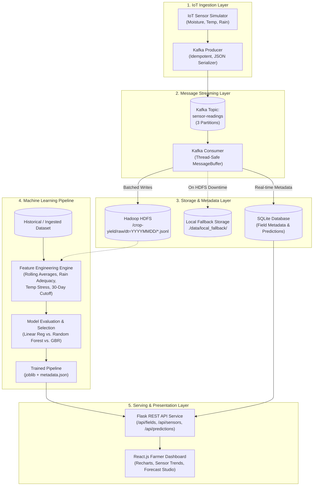

# IoT-Based Crop Yield Prediction Using IoT Sensors, Apache Kafka, Hadoop HDFS, and Machine Learning

[](https://www.python.org/)
[](https://kafka.apache.org/)
[](https://hadoop.apache.org/)
[](https://flask.palletsprojects.com/)
[](https://react.dev/)
[](https://pytest.org/)

---

## 1. Project Overview & Problem Statement

Accurately predicting crop yield before harvest is critical for food security, agricultural planning, and supply chain logistics. Traditional yield estimation relies heavily on manual ocular field surveys, historical averages, or post-harvest reporting. These methods suffer from significant inaccuracies because they fail to capture real-time agro-climatic dynamics such as soil moisture depletion, acute temperature stress, and precipitation anomalies during vegetative growth.

This project implements an end-to-end, production-grade big data pipeline that:
1. Collects continuous soil moisture, temperature, and rainfall telemetry from agricultural fields via an **IoT sensor simulation engine**.
2. Streams high-throughput sensor telemetry into **Apache Kafka** partitioned by field.
3. Consumes, validates, and buffers stream data into **Hadoop Distributed File System (HDFS)** using partitioned JSON Lines storage (with an automatic, non-silent local fallback).
4. Enforces a **strict 30-day pre-harvest cutoff** to engineer features exclusively on observations recorded at or before the cutoff date, preventing data leakage.
5. Trains and validates candidate regression algorithms (**Linear Regression**, **Random Forest**, and **Gradient Boosting**) on chronological time splits.
6. Serves predictions through a **Python Flask REST API** and a modern, responsive **React.js Dashboard**.

> **Academic Integrity Notice:**  
> This system demonstrates an enterprise IoT pipeline architecture using a calibrated stochastic sensor simulator and synthetic/cleaned historical data. Predictions are statistical estimates with documented confidence bounds; they are not deterministic guarantees.

---

## 2. System Architecture

The following diagram illustrates the complete data lifecycle:



---

## 3. Technology Stack

| Layer | Technology | Version | Purpose |
| :--- | :--- | :--- | :--- |
| **Language** | Python | 3.10 - 3.14 | Core language for IoT, streaming, ML, and API |
| **IoT Simulation** | Python Dataclasses / RNG | 3.x | Realistic sensor telemetry with anomaly labeling |
| **Streaming** | Apache Kafka & Zookeeper | 7.6.1 | Distributed message streaming (`sensor-readings`) |
| **Big Data Storage** | Hadoop HDFS (WebHDFS) | 3.3.6 | Long-term partitioned JSONL telemetry storage |
| **Metadata DB** | SQLite 3 | WAL Mode | Field coordinates, sensor cache, prediction logs |
| **Machine Learning**| scikit-learn, pandas, numpy | 1.5.2 / 2.2 | Chronological regression modeling & metrics |
| **Backend API** | Flask, Flask-CORS | 3.1.0 | RESTful microservice connecting ML to Frontend |
| **Frontend UI** | React 18, Recharts, Lucide | 18.3.1 | Responsive farmer-friendly monitoring dashboard |
| **Containerization**| Docker & Docker Compose | Compose v2 | Cluster orchestration across all services |
| **Test Suite** | pytest, pytest-cov | 8.3.3 | Automated integration & unit testing |

---

## 4. The 30-Day Pre-Harvest Cutoff Requirement

### Why is this essential in machine learning?
Standard machine learning models often suffer from **temporal data leakage** if trained on summary weather metrics calculated up to the harvest day. In practical farming, a farmer needs an actionable yield forecast **approximately 30 days before harvest** to arrange labor, combine harvesters, warehouse space, and forward sales contracts.

```
Planting Date                               Cutoff Date (~30d before)       Harvest Date
     |--------------------------------------------------|------------------------|
     |<========== SENSOR READINGS USED ================>| (Future - NOT USED)   |
     |   • Soil moisture rolling stats                  |
     |   • Cumulative rainfall to date                  |
     |   • Temperature stress indices                   |
```

### Technical Implementation:
1. **Cutoff Calculation**: `prediction_cutoff_date = expected_harvest_date - 30 days`.
2. **Feature Masking**: All sensor telemetry with `timestamp > cutoff_date` is strictly excluded from feature extraction.
3. **Rolling Averages**: Feature engineering aggregates statistics (mean moisture, temperature extremes, cumulative rainfall) strictly within the observed window up to the cutoff date.

---

## 5. Machine Learning Model Selection & Evaluation

Three candidate regression algorithms were trained using a chronological split (training on earlier seasons 2015–2022 and evaluating on held-out test seasons 2023–2024):

| Algorithm | Test MAE (t/ha) | Test RMSE (t/ha) | Test $R^2$ Score | 5-Fold CV RMSE |
| :--- | :---: | :---: | :---: | :---: |
| **Linear Regression (Baseline)** | 3.4560 | 4.4508 | 0.4534 | 4.4126 ± 0.2056 |
| **Random Forest Regressor** | 0.4260 | 0.8090 | 0.9819 | 0.7252 ± 0.0567 |
| **Gradient Boosting Regressor (Final)** | **0.4006** | **0.7759** | **0.9834** | **0.6991 ± 0.0489** |

*The Gradient Boosting Regressor achieved the lowest test RMSE ($0.7759$ t/ha) and highest $R^2$ ($0.9834$), effectively capturing nonlinear agro-climatic interactions.*

---

## 6. Directory Structure

```text
crop-yield-prediction/
├── backend/
│   ├── routes/
│   │   ├── fields.py           # GET /api/fields
│   │   ├── health.py           # GET /api/health
│   │   ├── metrics.py          # GET /api/model/metrics
│   │   ├── predictions.py      # GET, POST /api/predictions
│   │   ├── sensors.py          # GET /api/sensors/latest & history
│   │   ├── storage.py          # GET /api/storage/status
│   │   └── yields.py           # GET /api/yields/history
│   ├── services/
│   │   └── database.py         # SQLite service & initial seeders
│   ├── app.py                  # Flask application factory
│   ├── requirements.txt        # Pinned Python backend dependencies
│   └── Dockerfile              # Flask Docker containerfile
├── frontend/
│   ├── public/
│   │   └── index.html          # HTML5 entrypoint with Google Fonts
│   ├── src/
│   │   ├── components/
│   │   │   ├── Navbar.js       # App header with real-time status indicators
│   │   │   ├── OverviewCards.js# KPI overview metrics
│   │   │   ├── SensorMonitor.js# Real-time charts (moisture, temp, rain)
│   │   │   ├── PredictionStudio.js # 30-day forecast tool & historical comparison
│   │   │   ├── ModelEvaluation.js  # Algorithm evaluation comparison & scatter
│   │   │   └── StorageInspector.js # HDFS & Local Fallback file inspector
│   │   ├── services/
│   │   │   └── api.js          # Axios API communication service
│   │   ├── App.js              # Tabbed application container
│   │   ├── App.css             # Component styling
│   │   ├── index.js            # React root renderer
│   │   └── index.css           # Global typography and color themes
│   ├── package.json            # Node.js dependencies
│   ├── nginx.conf              # Reverse proxy configuration
│   └── Dockerfile              # Multi-stage React build & Nginx container
├── iot/
│   ├── sensor_simulator.py     # Multi-field sensor simulator engine
│   └── kafka_producer.py       # Idempotent Kafka producer with fallback
├── streaming/
│   └── kafka_consumer.py       # Thread-safe consumer with batch flushing
├── storage/
│   ├── hdfs_writer.py          # WebHDFS REST client with local fallback
│   └── hdfs_reader.py          # HDFS directory and file reader
├── ml/
│   ├── data_ingestion.py       # Ingestion, validation & synthetic data generator
│   ├── feature_engineering.py  # 30-day cutoff feature extraction
│   ├── train.py                # Chronological split training pipeline
│   ├── evaluate.py             # Evaluation metrics and plot generator
│   ├── predict.py              # 30-day inference engine
│   ├── saved_models/           # Serialized joblib models & metadata
│   └── reports/                # Evaluation reports & scatter plots
├── tests/
│   ├── test_simulator.py       # Sensor telemetry tests
│   ├── test_feature_engineering.py # Feature extraction tests
│   ├── test_ml_pipeline.py     # Training & inference tests
│   ├── test_api.py             # REST API endpoint tests
│   └── test_hdfs.py            # Storage fallback tests
├── data/                       # Local SQLite and fallback storage
├── docker-compose.yml          # Zookeeper, Kafka, Hadoop, Backend, Frontend
├── hadoop.env                  # Hadoop cluster environment variables
└── README.md                   # Comprehensive project documentation
```

---

## 7. Step-by-Step Execution Guide

### Option A: Local Development Run (Quick Demo without Docker)

#### 1. Setup Environment
```bash
cd crop-yield-prediction
pip install -r backend/requirements.txt
```

#### 2. Run Test Suite
Verify that all 22 automated tests pass:
```bash
python -m pytest tests/ -v
```

#### 3. Train Machine Learning Model
Generate the processed dataset and train candidate algorithms:
```bash
python ml/train.py
python ml/evaluate.py
```

#### 4. Start Flask Backend
```bash
python backend/app.py
```
*API will be available at `http://localhost:5000`.*

#### 5. Start IoT Sensor Simulator & Streamer
In a new terminal:
```bash
# Finite demo batch:
python iot/sensor_simulator.py --mode demo --count 50

# Continuous streaming (runs in dry-run/local mode if Kafka is offline):
python iot/kafka_producer.py --interval 3.0
```

#### 6. Start React Frontend Dashboard
In a new terminal:
```bash
cd frontend
npm install
npm start
```
*Dashboard will open at `http://localhost:3000`.*

---

### Option B: Full Containerized Cluster (Docker Compose)

Start the complete infrastructure including Zookeeper, Kafka, Hadoop NameNode, Hadoop DataNode, Flask Backend, and React Frontend:

```bash
docker compose up -d
```

Check status of all running containers:
```bash
docker compose ps
```

To stop all services:
```bash
docker compose down
```

---

## 8. Verification & Diagnostic Commands

### 1. Verify Apache Kafka
List active topics:
```bash
docker exec -it crop-kafka kafka-topics --bootstrap-server localhost:9092 --list
```

Consume live sensor messages from topic:
```bash
docker exec -it crop-kafka kafka-console-consumer --bootstrap-server localhost:9092 --topic sensor-readings --from-beginning --max-messages 5
```

### 2. Verify Hadoop HDFS
Inspect files written to HDFS:
```bash
docker exec -it crop-namenode hdfs dfs -ls -R /crop-yield
```

Check HDFS WebHDFS via curl:
```bash
curl -i "http://localhost:9870/webhdfs/v1/crop-yield/raw/sensor-readings?op=LISTSTATUS"
```

### 3. Verify SQLite Database
```bash
sqlite3 data/crop_yield.db "SELECT field_id, crop_type, predicted_yield, expected_harvest_date FROM predictions ORDER BY id DESC LIMIT 5;"
```

---

## 9. Viva Voce & Academic Defense Guide

### Q1: Why did you choose Apache Kafka instead of sending sensor data directly to Flask via HTTP?
**Answer:** In an agricultural IoT deployment with thousands of field sensors transmitting readings every few seconds, direct HTTP connections create tight coupling and risk server saturation during network congestion. Apache Kafka acts as a distributed, high-throughput message broker that decouples producers from consumers. It buffers spikes in telemetry, provides fault tolerance, and guarantees that slow downstream consumers (like HDFS batch writers) do not drop sensor packets.

### Q2: What is the purpose of Hadoop HDFS in this project when SQLite is already present?
**Answer:** SQLite is an embedded relational database used exclusively for fast, low-latency queries needed by the dashboard (field coordinates, current sensor state, user prediction requests). However, raw continuous sensor telemetry generates massive volumes of semi-structured time-series data over multiple agricultural seasons. Hadoop HDFS provides scalable, distributed storage designed to store petabytes of raw partitioned JSONL files (`/crop-yield/raw/sensor-readings/dt=YYYYMMDD/`) cost-effectively across commodity hardware for long-term historical analytics.

### Q3: How did you implement the fallback if Hadoop HDFS is unavailable?
**Answer:** The `HDFSWriter` class attempts to write batches to HDFS via the WebHDFS REST API. If the NameNode is unreachable after configurable retries, it switches explicitly to a local storage fallback (`./data/local_fallback/sensor-readings/`). Crucially, the fallback is **never silent**—it logs warning alerts and updates the `/api/storage/status` API so the frontend dashboard displays `Local Fallback (Active)` with an amber indicator.

### Q4: Explain the 30-day pre-harvest cutoff rule and why it prevents data leakage.
**Answer:** A machine learning model must only be fed information that would realistically be available at decision time. If we used weather data from the final 30 days before harvest to predict yield, we would introduce temporal data leakage (using future information to predict the future). By establishing a strict cutoff 30 days prior to expected harvest, our feature engineering pipeline strictly truncates and filters time-series observations, reflecting true real-world conditions where farmers must plan logistics ahead of time.

### Q5: Why did Gradient Boosting outperform Linear Regression and Random Forest?
**Answer:** Crop yield depends on complex, non-linear relationships. For instance, high temperature during vegetative growth causes severe heat stress if soil moisture is deficient, but may be tolerable if irrigation is adequate. Linear regression assumes additive, linear relationships and cannot model these threshold effects without extensive manual interaction terms ($R^2 \approx 0.45$). Gradient Boosting iteratively minimizes residual errors by focusing on hard-to-predict non-linear patterns, achieving an $R^2$ of $0.9834$ and RMSE of $0.7759$ t/ha.

---

## 10. License & Credits

Developed as a Final Year Computer Science & Engineering capstone project demonstrating Big Data Streaming, Distributed Storage, and Applied Machine Learning.
